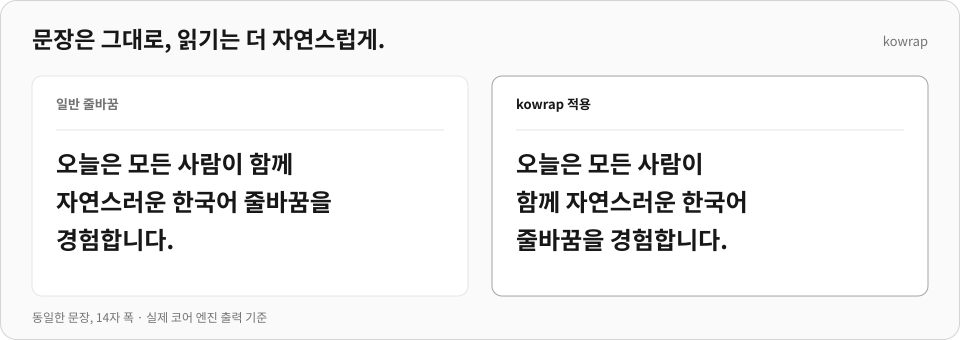

# kowrap

한국어를 읽는 흐름에 맞춰 자연스럽게 줄바꿈하는 라이브러리입니다.

실제 글자 폭과 한국어 어절 및 문장 경계를 고려하여 제목과 문장의 줄바꿈을 최적화합니다.

[체험하기](https://oddmash.github.io/kowrap/#playground) | [문서](https://oddmash.github.io/kowrap/docs/) | [npm](https://www.npmjs.com/package/@oddmash/kowrap)

## 특징

- 한국어 어절을 보존하는 균형 잡힌 줄바꿈
- 화면 폭 변화에 따른 자동 재계산
- 의도적인 개행 위치 지정
- 강조, 링크 등 인라인 마크업 유지
- React, Next.js, Vue, Svelte 및 일반 HTML 지원

## 지원 범위

kowrap은 제목과 짧은 문장에 적합합니다. 강조와 링크를 포함한 중첩 인라인 텍스트도 지원합니다.

[기여 안내](CONTRIBUTING.md)
