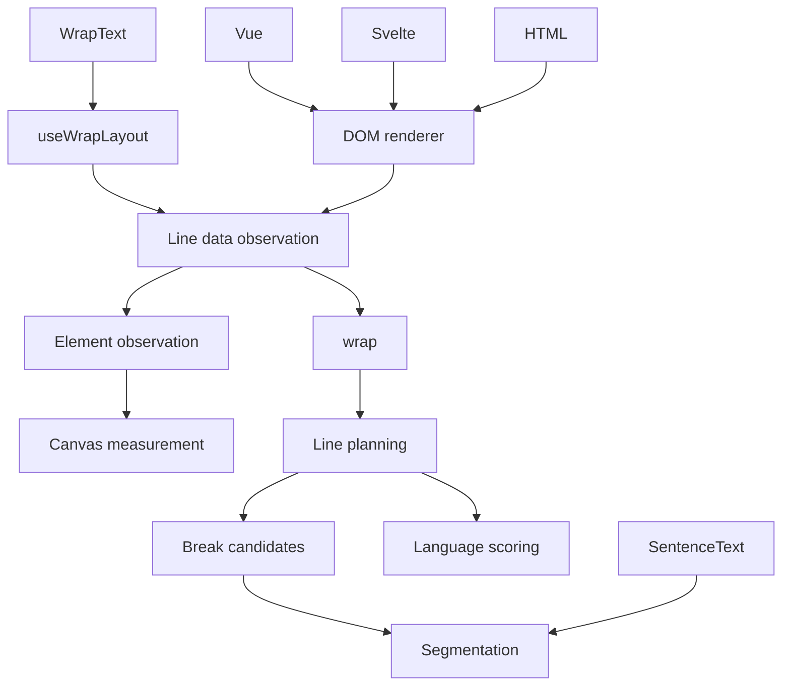

# kowrap 아키텍처

kowrap은 원문과 폭 측정 함수를 받아 줄 경계를 고르는 프레임워크 독립 엔진이다. React와 브라우저는 엔진의 소비자이며 엔진에 역방향 의존성을 추가하지 않는다.

## 공개 진입점

| 경로 | 공개 책임 |
| --- | --- |
| `@oddmash/kowrap` | `wrap`, `splitLines`, `segmentSentences`, 코어 타입 |
| `@oddmash/kowrap/dom`, `@oddmash/kowrap/browser` | `createCanvasMeasure`, `observeKowrap`, `mountKowrap` |
| `@oddmash/kowrap/react` | `WrapText`, `useKowrap`, React 클라이언트 컴포넌트 |
| `@oddmash/kowrap/react/server` | `SentenceText`, 클라이언트 실행 없는 서버 컴포넌트 |
| `@oddmash/kowrap/vue` | Vue 3 디렉티브 |
| `@oddmash/kowrap/svelte` | Svelte 액션 |

## 내부 모듈

```text
src/
  index.ts
  core/
    types.ts
    segmentation.ts
    boundaries.ts
    scoring.ts
    layout.ts
    wrap.ts
  dom/
    index.ts
    types.ts
    measure.ts
    observe-element.ts
    observe.ts
    render.ts
  adapters/
    react/
      index.ts
      types.ts
      wrap-text.tsx
      use-wrap-layout.ts
      use-kowrap.ts
      server.tsx
    vue/
      index.ts
    svelte/
      index.ts
examples/
  html/
    index.html
```



## 엔진 데이터 흐름

1. `wrap.ts`가 입력 폭과 측정 함수를 검증하고 원문의 명시적 개행 및 강제 UTF-16 경계를 보존한다.
2. `segmentation.ts`가 Unicode grapheme과 공백, 문장 분리를 처리한다.
3. `boundaries.ts`가 가능한 어절 경계를 생성한다. 긴 어절만 비상 grapheme 경계를 추가한다.
4. `layout.ts`가 레이아웃 전략을 선택한다. `greedy`는 현재 줄에서 가장 긴 후보를 고르며 앞으로 진행하고, `balanced`는 동적 계획법으로 줄 수를 최소화한 뒤 비용을 비교한다.
5. `scoring.ts`는 줄 여백, 넘침, 문장부호와 한국어 수식 관계에 대한 비용만 담당한다.
6. `wrap.ts`가 내부 범위를 원문의 UTF-16 범위로 복원한다. `text + breakAfter`를 이어 붙이면 원문과 같아야 한다.

## React 및 SSR 경계

React 클라이언트 컴포넌트는 렌더링만 담당하고 `useWrapLayout`이 SSR 이후 측정 및 상태 업데이트를 담당한다. `observeElementLayout`은 해당 DOM 요소의 문서와 창을 기준으로 크기 및 폰트 변경을 구독한다. 글꼴 속성이 동일한 리사이즈에서는 Canvas 측정기를 재사용하며, 폰트 로딩 완료 시 다시 만든다.

서버 컴포넌트는 문장 분리만 사용하며 Hook 또는 브라우저 모듈을 참조하지 않는다. 초기 클라이언트 렌더링은 SSR과 동일한 원문을 사용한다.

HTML, Vue, Svelte는 공통 브라우저 컨트롤러를 사용한다. `observeKowrap`은 측정 및 줄 데이터만 전달하며 DOM을 소유하지 않는다. `mountKowrap`은 텍스트 전용 요소의 자식 렌더링을 소유하고 업데이트·해제와 스타일 복원까지 담당한다. 강제 경계는 코어에서 처리하므로 환경별로 결과가 달라지지 않는다.

일반 HTML은 별도 프레임워크 어댑터가 아니다. `dom/measure.ts`는 Canvas 측정, `dom/observe-element.ts`는 DOM 폭과 폰트 관찰, `dom/observe.ts`는 엔진 호출과 줄 데이터 전달, `dom/render.ts`는 DOM 출력과 해제를 담당한다. 실제 HTML 사용 예시는 `examples/html/`에 둔다.

## 변경 기준

- 공개 경로 및 기존 타입은 호환성을 유지한다.
- 한국어 휴리스틱 수정은 `scoring.ts`, 분리 규칙 수정은 `segmentation.ts`와 `boundaries.ts`에서 진행한다.
- 엔진 개선 시 브라우저나 React 의존성을 추가하지 않는다.
- 패키지 빌드 전 이전 생성물만 제거하며, 배포 파일에 미사용 모듈이나 테스트를 남기지 않는다.
